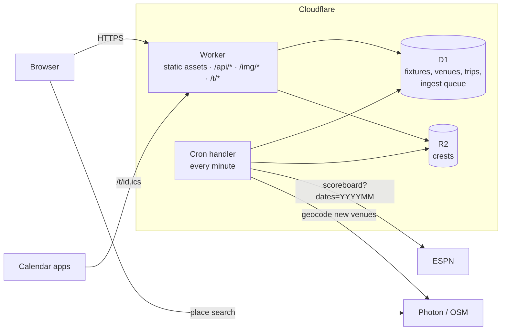

# footyplanner

Going on holiday somewhere in Europe and want to catch a footy game whilst you're there? footyplanner is a way to view all football matches on across Europe for a set of dates.

It runs at [footyplanner.co.uk](https://footyplanner.co.uk) on Cloudflare Workers. A cron job pulls fixtures from ESPN into a D1 SQLite database every minute, locates stadiums on OpenStreetMap and copies static resources into R2; the API serves from D1 and is cached at Cloudflare's edge. No API keys, and it fits Cloudflare's Free plan. It was rebuilt from a single HTML page one step at a time: see [docs/PLAN.md](docs/PLAN.md) and the decision records in [docs/adr/](docs/adr/).

## How it works

- **Fixtures** come from ESPN's public scoreboard API. Only the cron job calls it (see [Ingestion](#ingestion)); the page never does. The page asks the Worker for every fixture in the chosen dates with one `/api/fixtures` request which is then fetched from the databases, then filters by competition or location in the browser. Live matches are refreshed every 2 minutes with the latest score.
- **Venue locations:** ESPN gives the venue name, city and country, but no coordinates. The cron looks each new venue up on [Photon](https://photon.komoot.io) (OpenStreetMap): the city first, then the nearest stadium within 40 km. A venue which fails to be found, is located at the centre of the city and displays "Location is approximate".
- **Kick-off times** use the venue's time zone, worked out from its country, with your own local time shown next to it. The view options menu (top right of the panel) switches between venue time and your own.
- **Club/Competition Badges** are copied from ESPN into R2 by the cron and served from `/img/...`, so the page never needs to fetch images from ESPN whilst loading the page.
- **Map tiles** come from Esri basemaps, which need no key.

## Architecture



One Worker serves the page, the API and the trip feeds, and runs the cron ([ADR 0002](docs/adr/0002-one-worker-for-page-api-and-cron.md)). Static files are served without running the Worker. Visitor requests only read D1 and R2, and most are answered from Cloudflare's edge cache; only the cron talks to ESPN and Photon ([ADR 0008](docs/adr/0008-cron-only-ingestion.md)). The browser's place search calls Photon directly ([ADR 0014](docs/adr/0014-place-search-calls-photon-from-the-browser.md)).

## Planning a trip

- **Near:** tap the place button next to the dates, then type a city, hotel or address, or use your current location. Then pick a distance (25–400 km). Only matches within that circle are listed, each with its distance and a rough travel time. Driving is estimated from straight-line distance; beyond 600 km it assumes a flight with about 3 hours of airports. You can sort by time or distance.
- **Shortlist:** tap ☆ on any match or map popup.
    - The Shortlist tab lists your picks as a day-by-day itinerary with travel between games. It warns about same-time kick-offs, overlaps, and trips you can't make between the final whistle and the next kick-off. The route is drawn on the map.
    - "Add all to calendar" downloads an `.ics` file. Matches without a confirmed time become all-day events marked "time TBC".
    - Saved matches keep updating with whatever the page loads, so moved kick-offs and confirmed times show.
    - "Save trip" saves the shortlist as a trip with a link to share, a private edit link for another browser, and a calendar feed to subscribe to. After that, changes to the shortlist are saved to the trip as you make them. Anyone with the link sees the trip read-only and can copy it to their own shortlist.
- **Unconfirmed kick-offs:** when a time is still TBC, the page shows when that league usually confirms times (for example, the Premier League about 5–6 weeks ahead and La Liga only 1–3 weeks ahead) and the expected date. It also notes that the match can move to another day of that weekend for TV. These are rules of thumb, not guarantees.

## Ingestion

A Cron Trigger runs the Worker every minute. Cloudflare Workers Free plan gives each run 10 ms of CPU time, so the work is distributed into many smaller chunks to stay within the Free plan limit.:

Each Cron run can be either;

- **Sweep:** Claims the next league-month (a single month for a single competition) from the `ingest_queue` (a to-do list of all the competitions and months which need fetching) and fetches all the fixtures for that competition from ESPN. Only fixtures that changed are written. Moved kick-offs, confirmed times and postponements are logged in `fixture_changes`. . Depending on how close the month is, the fixtures are re-fetched every few hours or daily.
- **Live:** on even minutes and if a competition has a live match, it's scores are fetched, so scores are at most about 2 minutes old. If no matches are being played, there is no need to fetch the score, therefore no 'live' run.

**Fixtures** fetched from ESPN return the stadium name and location, which are then geolocated using [Photon](https://photon.komoot.io) (OpenStreetMap) and it's coordinates inserted into the D1 database. At the end of every cron run, if there are stadiums which don't currently have any coordinates the cron run will resolve a single stadiums location.

Similarly, if a **team/competition badge** isn't currently saved in the R2 database, at the end of every cron run it will copy at most 3 badges into R2. These badges (static files) can then be served from /img/*.

Every run is logged in `ingest_runs`, and `/api/status` summarises freshness per competition.

## Competitions and venues

Competitions, venues and overrides live in D1. The first seed came from the tables the page used to hard-code. To add a competition, add a migration that inserts a row into `competitions` (an ESPN league slug such as `ned.1`); the next hourly run queues its months. To fix a stadium pin, add a row to `venue_overrides`.

## Repo layout

```
apps/api/            Cloudflare Worker (Hono): API routes, cron ingestion, wrangler.jsonc
  src/db/            Drizzle schema
  src/ingest/        the cron job: parse, diff, queue, venues, images
  src/routes/        /api/* and /img/*
  migrations/        D1 migrations (schema from drizzle-kit, plus seed data)
  test/              Vitest, run inside the Workers runtime with local D1 and R2
apps/web/            the React app (Vite), served at /
  src/               components, API client (Hono RPC) and queries (TanStack Query)
  e2e/               Playwright tests and their seed data
packages/shared/     code used by both: API response types, ESPN types, distance and region checks
```

It's a pnpm workspace. Install with `pnpm install` (Node 22+; `corepack enable` gives you pnpm if you don't have it).

## API

The Worker only runs for `/api/*`, `/img/*` and `/t/*`; everything else is served straight from the static assets. Responses are cached at Cloudflare's edge (Workers Cache, via `Cloudflare-CDN-Cache-Control`), and requests that miss the cache are rate-limited per IP (120 a minute).

- **`/api/fixtures?from=YYYY-MM-DD&to=YYYY-MM-DD[&comps=eng.1,esp.1,…]`** every fixture in the range (whole UTC days, up to 62) for the listed competitions, or every active one when `comps` is left out, from D1, with teams, crests, score, status and venue coordinates. Cached for 60 s when the range touches today, an hour for future ranges and a day for past ones.
- **`/api/competitions`** the competitions, their groups and colours, logos and TBC guidance.
- **`/api/status`** the last cron run and, per competition, how many months have been fetched, when last and whether any are failing.
- **`POST /api/trips`** saves a trip, `{ name?, fixtureIds }` (1–50 listed fixtures), and returns its public `id` and a secret `editToken`. Limited to 10 a minute per IP.
- **`GET /api/trips/<id>`** the trip with its fixtures as they are now, and any ESPN no longer lists under `missing`. Never cached.
- **`PUT /api/trips/<id>`** replaces the trip; needs `Authorization: Bearer <editToken>`.
- **`/t/<id>.ics`** the trip as a calendar feed to subscribe to, cached for 15 minutes. `/t/<id>` opens the page for a trip that exists.
- **`/img/teams/<id>.png`, `/img/leagues/<slug>.png`** crests and logos from R2.

Errors and bad requests are sent with `Cache-Control: no-store` so they're never cached. Only the cron calls ESPN and Photon; the page's place search calls Photon from the browser.

## Development

```
pnpm build          # build the React app into apps/web/dist
pnpm dev            # wrangler dev on http://localhost:8787 (built pages + API); run pnpm build first
pnpm --filter @footyplanner/web dev   # Vite with hot reload on http://localhost:5173/, proxying /api to :8787
pnpm e2e            # Playwright against wrangler dev with a seeded local database
pnpm test           # Vitest; the API tests run inside the Workers runtime
pnpm typecheck
pnpm lint
pnpm format         # Prettier
```

After changing `apps/api/wrangler.jsonc`, run `pnpm --filter @footyplanner/api types` to regenerate `worker-configuration.d.ts`.

The local database starts empty. From `apps/api`:

```
pnpm db:migrate:local                 # create tables and seed data in the local D1
pnpm exec wrangler dev --test-scheduled
curl "http://localhost:8787/__scheduled?cron=*+*+*+*+*"   # run the cron once
```

After changing `src/db/schema.ts`, run `pnpm db:generate` to write a migration, then `pnpm db:migrate:local`.

## Deploying (Cloudflare)

GitHub Actions (`.github/workflows/ci.yml`) checks formatting, lint, types, tests and the frontend build on every pull request and push, and runs the Playwright tests in a separate job. Pull requests also upload a preview version (`pr-<number>-footyplanner.<account>.workers.dev`) and comment a link to it. Pushes to `main` apply D1 migrations, then deploy with `wrangler deploy`. Migrations have to stay backwards compatible (add columns and tables, don't rename or drop), because the previous version keeps serving until the deploy finishes, and preview versions share the production database.

The deploy jobs need two repository secrets:

- `CLOUDFLARE_ACCOUNT_ID`: from the Cloudflare dashboard (Workers & Pages, right-hand side).
- `CLOUDFLARE_API_TOKEN`: create one with the "Edit Cloudflare Workers" template, and add **D1: Edit** to its permissions for migrations. Its zone resources must include `footyplanner.co.uk`, so the deploy can attach the custom domain.

The Worker is served only on `footyplanner.co.uk` (`routes` in `apps/api/wrangler.jsonc`); `workers.dev` is turned off so the zone's WAF and rate limiting rules can't be bypassed, while preview URLs stay on ([ADR 0019](docs/adr/0019-custom-domain-with-workers-dev-off.md)). To run your own copy, change the route to a domain on your Cloudflare account.

To deploy by hand: `pnpm exec wrangler login` once, then `pnpm deploy`.

Because previews share the production database, a pull request that adds a migration can't use the new tables on its preview until it merges, unless the migration is applied first with `pnpm --filter @footyplanner/api db:migrate:remote`.

The cron starts on its own and fills the fixtures at one league-month a minute, about six hours for the seeded competitions; `/api/status` shows how far it has got. The rate-limit `namespace_id`s in `wrangler.jsonc` are just numbers you choose and need nothing created.
