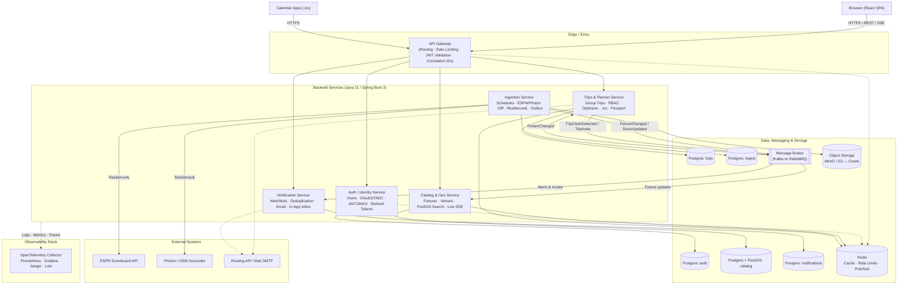

# footyplanner v2 — Learning & Architecture Plan

- **Status:** Draft (living document — major decisions will be finalised one chunk at a time via ADRs)
- **Primary goal:** Use FootyPlanner v2 as a hands-on learning platform for real-world production backend engineering, system design, Java/Spring Boot, databases, observability, performance optimization, and microservices.
- **Relationship to v1:** Keep v1 (`footyplanner.co.uk` on Cloudflare Workers) intact and unaffected while v2 is built from the ground up. Early on, v2 can reuse the existing React frontend (`apps/web`) by swapping its API client to an OpenAPI-generated client so learning stays focused on backend and systems engineering.

## Guiding Principles

1. **Understanding over shipping speed.** Never introduce a library, pattern, or infrastructure component until we understand the concrete problem it solves and its trade-offs.
2. **Modular monolith first, microservices second.** Start with a single Spring Boot application organized into strict domain modules, then extract services one by one so we actually feel the costs and benefits of distribution.
3. **Measure before optimizing.** Baseline latency, throughput, SQL execution plans, and resource usage before tuning queries, connection pools, or caching.
4. **Separate reversible from irreversible choices.** Spend extra time on expensive-to-change decisions (data ownership, primary keys, event contracts, auth tokens) and move quickly on cheap-to-change ones (DTO fields, cache TTLs, UI layouts).

---

## 1. Features & Expanding the Domain

FootyPlanner v1 is a mostly read-only fixture map plus anonymous saved trips—too thin on its own to justify multiple services. Expanding the domain around realistic **European football travel** problems naturally creates distinct workloads (geospatial reads, multi-user transactional writes, flaky upstream ingestion, event-driven fan-out, real-time push, and route optimization).

### 1.1 Core Parity & Server-Side Geospatial Discovery

- Retain v1's core value: browsing European fixtures across 26+ competitions by date range, competition, text search, and "Near a place" radius, with venue overrides, TBC guidance, and self-hosted crests.
- **v2 upgrade:** Move filtering, sorting, pagination, and spatial radius / map-viewport queries into **PostgreSQL + PostGIS** instead of shipping 62 days of all European fixtures to the browser.

### 1.2 User Accounts & Identity

- Public fixture browsing works without an account (still giving us mixed public + authenticated routes), while trips and personal features require signing in—no need to preserve v1's legacy anonymous edit-token or read-only shared trip links.
- Authenticated accounts (email/password with Argon2/BCrypt and/or OAuth2/OIDC login) unlock cross-device shortlists, saved trips, home-base preferences, favourite competitions, and alert settings.

### 1.3 Collaborative Group Trips

- Build **multi-user trips** from scratch with role-based access control (**Owner**, **Editor**, **Viewer**), shareable invite links, and live subscribable `.ics` trip feeds.
- Add group planning features: per-fixture voting (interested / can't make it), trip notes, and **concurrency protection** (optimistic locking + conflict handling when multiple collaborators edit a trip simultaneously).

### 1.4 Watchlists & Event-Driven Fixture Alerts

- Users can watch individual fixtures, teams, or automatically watch all fixtures in their upcoming trips.
- When ingestion detects changes (kick-off moved, TBC time confirmed, fixture postponed/cancelled—building on v1's `fixture_changes` concept):
    1. Emit structured domain events (`FixtureRescheduled`, `FixtureTimeConfirmed`, `FixturePostponed`).
    2. Automatically **re-evaluate affected trips** for newly introduced kick-off overlaps or impossible transfers (`TripClashDetected`).
    3. Deliver deduplicated alerts via an in-app notification inbox, email (Mailpit locally / SMTP in prod), or optional webhook.
- Show "Changed since you last checked" indicators on saved trips.

### 1.5 Smart Itinerary / Trip Optimizer

- Given a base Place, date window, preferred competitions, and max travel budget/time, generate ranked multi-match itineraries that are physically feasible.
- Upgrade travel-time estimates beyond straight-line Haversine by introducing a cached routing/distance layer (e.g., venue-to-venue travel matrix backed by an external routing API with graceful fallback to Haversine).

### 1.6 Live Matchday Push & Groundhopping Passport

- **Real-time live scores:** Push live score and match status transitions (`PRE → IN → POST`) to connected browsers using **Server-Sent Events (SSE)** fanned out via Redis Pub/Sub so it works across multiple backend replicas.
- **Groundhopping passport:** Let users log attended fixtures/venues to track personal stats (stadiums visited, countries/competitions completed, distance travelled, season recaps)—a natural playground for SQL aggregations, materialized views, or read models.

### Deliberately Out of Scope

To avoid turning this into an unfinishable product: no ticket checkout/payments, no hotel/flight booking engine, no social media feed/DMs, and no native mobile apps.

---

## 2. Rough Target Architecture (Multi-Service End State)

This diagram shows the **eventual target architecture** after services are extracted in Phase 5. In Phases 0–4, the five core boxes live inside a single **Spring Boot Modular Monolith** with strict package and schema boundaries.



### Target Service Responsibilities & Learning Focus

| Service             | Owns                                                                    | Sync / Async Interface                                                                                                       | Key Concepts Learned                                                                                                   |
| ------------------- | ----------------------------------------------------------------------- | ---------------------------------------------------------------------------------------------------------------------------- | ---------------------------------------------------------------------------------------------------------------------- |
| **API Gateway**     | Edge routing, rate-limit counters, request tracing headers              | Proxies HTTP/SSE to services; validates JWTs via JWKS                                                                        | Reverse proxies, token-bucket rate limiting, CORS, correlation IDs, central edge policies                              |
| **Auth / Identity** | Users, credentials, OAuth2 links, refresh token sessions                | REST (`/auth/*`, `/.well-known/jwks.json`)                                                                                   | Spring Security internals, Argon2/BCrypt, asymmetric JWT signing, refresh token rotation & revocation                  |
| **Ingestion**       | Ingest schedules, run logs, raw diffs, outbox table, crests in S3/MinIO | Background worker (no public user traffic); publishes `FixtureChanged`, `ScoreUpdated`, `VenueGeocoded`                      | Resilience4j (circuit breakers, retries, bulkheads), Transactional Outbox, idempotent upserts, flaky upstream handling |
| **Catalog & Geo**   | Read-optimized competitions, teams, venues (PostGIS), fixtures          | REST (`/api/v1/fixtures`, `/competitions`), SSE (`/api/v1/live`); consumes fixture events                                    | PostGIS spatial queries & `GIST` indexes, `EXPLAIN ANALYZE`, Redis cache-aside & invalidation, SSE via Redis Pub/Sub   |
| **Trips & Planner** | Trips, collaborators/roles, votes, groundhopping logs, travel matrices  | REST (`/api/v1/trips`, `/t/{id}.ics`, `/optimizer`); consumes `FixtureChanged`, publishes `TripClashDetected` / `TripInvite` | Transactional invariants, RBAC, `@Version` optimistic locking, itinerary optimization algorithms, materialized views   |
| **Notification**    | Watchlists, alert preferences, delivery log, in-app inbox               | REST (`/api/v1/notifications`); consumes fixture & trip events                                                               | Event-driven fan-out, consumer idempotency, retries with backoff, Dead-Letter Queues (DLQs)                            |

### Major Decisions Intentionally Deferred (To Be Decided Together via ADRs)

Rather than locking these in upfront, we will evaluate trade-offs and write an ADR when we reach the relevant phase:

- **Repo structure:** Decided — separate repository duplicated from v1 ([ADR 0001](adr-v2/0001-separate-repository-for-v2.md)).
- **Build tool:** Maven vs Gradle (Kotlin DSL).
- **Persistence library:** Spring Data JPA / Hibernate vs jOOQ vs Spring Data JDBC (especially important given PostGIS queries and N+1 tradeoffs).
- **Message broker:** Apache Kafka vs RabbitMQ.
- **Auth approach:** Spring Authorization Server vs custom JWT auth module vs Keycloak.
- **Real-time transport:** SSE vs WebSockets.
- **Inter-service sync calls (where unavoidable):** OpenAPI/RestClient vs gRPC.
- **Deployment target:** Docker Compose on a single VPS vs managed cloud vs k3s/Kubernetes.

---

## 3. Phased Roadmap

Each phase is broken into small vertical chunks (~1–3 sessions each). Infrastructure is only added when a phase gives it a concrete job to do.

### Phase 0 — Foundation & Local Production-Like Sandbox

**Goal:** Establish the Java 21 / Spring Boot 3 modular monolith skeleton, local Docker environment, and test harness.

- **0a. Workspace & project setup:** Decide repo layout & build tool (ADR), configure Spring Boot 3, Java 21, Checkstyle/Spotless formatting, and strict top-level module packages (`catalog`, `ingest`, `trips`, `auth`, `notifications`).
- **0b. Local infrastructure & testing foundation:** `docker-compose.yml` (PostgreSQL + PostGIS, MinIO), Flyway migration setup, Spring Actuator health probes, and a working **Testcontainers** integration test baseline.

**Done when:** Tests boot a real Postgres+PostGIS container via Testcontainers, apply Flyway migrations, and pass; the app starts locally with `/actuator/health` green.

---

### Phase 1 — Core Domain Monolith (Fixtures, Geo Search & Ingestion)

**Goal:** Reach functional parity with v1's map and ingestion on Spring Boot + PostGIS, with real resilience and server-side spatial search.

- **1a. Core database schema & PostGIS model:** Flyway migrations for `competitions`, `teams`, `venues`, `venue_overrides`, `fixtures`, `fixture_changes`, plus spatial geometry/geography columns and `GIST` indexes.
- **1b. Ingestion pipeline & WireMock test harness:** Port ESPN & Photon HTTP clients (`RestClient`), idempotent diff/upsert logic, crest copying to MinIO, and offline integration tests using **WireMock** (including upstream failures/403s/timeouts).
- **1c. Upstream resilience & scheduling:** Add **Resilience4j** (circuit breaker, retry with jitter, rate limiter) and a clean scheduler/queue mechanism for sweeps and live refreshes.
- **1d. Catalog & Geospatial REST API:** Build `/api/v1/fixtures`, `/api/v1/competitions`, `/api/v1/status` with PostGIS radius & viewport queries, server-side pagination/filtering, RFC 7807 `ProblemDetail` errors, and OpenAPI docs.
- **1e. Frontend integration:** Point the existing React app (`apps/web`) at the Spring Boot API using OpenAPI-generated TypeScript types.

**Done when:** You can browse live-ingested European fixtures on the map powered by Spring Boot + PostGIS + MinIO, with full Testcontainers + WireMock coverage.

---

### Phase 2 — Observability, Load Testing & Performance Optimization

**Goal:** Learn to see inside a running production system, find real bottlenecks under load, and prove optimizations with numbers.

- **2a. The three pillars locally:** Add structured JSON logging with Trace IDs, Micrometer → **Prometheus + Grafana**, and **OpenTelemetry → Jaeger** to `docker-compose.yml`.
- **2b. Baseline load tests & SQL tuning:** Write **k6** scripts simulating browsing + Saturday matchday peaks; analyze queries with `EXPLAIN ANALYZE`; tune indexes, **HikariCP** pool settings, and Java 21 virtual threads.
- **2c. Multi-tier caching with Redis:** Add Redis cache-aside for hot fixture ranges & competitions, event/write-driven cache invalidation when ingestion updates fixtures, and measure hit ratios and p99 latency drops.
- **2d. Controlled failure drills:** Deliberately slow down WireMock ESPN, stop Redis, and cap DB connections under load; verify graceful degradation, metrics, and alert thresholds.

**Done when:** Grafana displays RED metrics, JVM/HikariCP health, cache hit rate, and ingestion lag; before/after k6 benchmark numbers are documented.

---

### Phase 3 — Identity, Security & Collaborative Trips

**Goal:** Master authentication, authorization, multi-user transactional writes, and concurrency control.

- **3a. Authentication & security internals:** Configure **Spring Security** (`SecurityFilterChain`), password hashing (Argon2/BCrypt), asymmetric JWT access tokens + rotating revocable refresh tokens (and optional OAuth2 login).
- **3b. User trips & calendar feeds:** Build account-owned saved trips and `.ics` trip feeds (no legacy anonymous trip migration needed).
- **3c. Group collaboration & concurrency:** Add trip collaborators with RBAC (`OWNER` / `EDITOR` / `VIEWER`), invite tokens, fixture voting/notes, and **optimistic locking (`@Version`)** verified by concurrent-write tests.
- **3d. Groundhopping passport:** Attended-match logging and personal travel/stadium statistics backed by optimized SQL aggregations / materialized views.

**Done when:** Multiple users can safely co-edit trips with tested 401/403 enforcement, token rotation, and conflict handling on simultaneous updates.

---

### Phase 4 — Event-Driven Architecture, Alerts & Real-Time Features

**Goal:** Decouple modules with asynchronous events, guarantee reliable delivery, and stream live updates across replicas.

- **4a. Message broker & Transactional Outbox:** Add **Kafka (or RabbitMQ)** to Docker Compose; implement the **Transactional Outbox** pattern in Ingestion so DB writes and published `FixtureChanged` / `ScoreUpdated` events never drift.
- **4b. Automated clash detection:** Trips module consumes `FixtureChanged`, recalculates itinerary clashes for affected upcoming trips, and emits `TripClashDetected`.
- **4c. Notification engine:** Watchlists, user preferences, consumer idempotency, deduplication, retry + **Dead-Letter Queue (DLQ)**, in-app alert inbox, and local email testing via **Mailpit**.
- **4d. Real-time live scores (SSE):** Stream live score updates over SSE backed by **Redis Pub/Sub**, verified while running 2 backend instances behind a proxy.
- **4e. Trip optimizer:** Cached venue travel-time matrix + feasible multi-match itinerary generator for a given base place and dates.

**Done when:** Simulating a moved kick-off in WireMock flows end-to-end (Ingest → Outbox → Broker → Clash Re-check → Email in Mailpit + In-App Alert) as one connected trace in Jaeger.

---

### Phase 5 — Microservices Extraction & Production Deployment

**Goal:** Experience real distributed systems by peeling modules out into independent deployables without breaking the system.

- **5a. API Gateway:** Put **Spring Cloud Gateway** in front with centralized routing, Redis-backed distributed rate limiting, and JWKS JWT verification.
- **5b. First extraction — Notification Service:** Peel out Notifications first (pure async consumer = lowest-risk split); give it its own DB, Dockerfile, and contract tests.
- **5c. Second extraction — Ingestion Service:** Isolate upstream polling, Resilience4j policies, and MinIO uploads into its own service + DB.
- **5d. Third extraction — Auth Service (optional):** Separate identity issuing (JWKS endpoint) from downstream resource servers.
- **5e. Production readiness & deployment:** Multi-stage Docker builds, graceful shutdown, CI/CD pipeline, Infrastructure as Code (**Terraform**), and deployment to a cloud/VPS or k3s environment.

**Done when:** Independent services run behind the gateway, survive single-service restarts gracefully, and produce unified distributed traces across every network hop.

---

## 4. Ways of Working

The goal is to replace "vibe coding" with a deliberate, repeatable loop where **you own every architectural decision and deeply understand every layer we build**.

### The 6-Step Chunk Loop

Every small chunk in the roadmap follows this rhythm:

1. **Scope the Chunk (Mini-Spec)**
    - Agree on a narrow, concrete slice of work: exact user/system behaviour, edge cases, and what is explicitly out of scope for now.
2. **Explore the Design & Trade-Offs Together ("The Why")**
    - Before writing code, unpack the concepts, Spring/library internals, and candidate approaches.
    - Explicitly compare:
        - **Trade-offs** (simplicity vs flexibility, consistency vs latency, operational overhead).
        - **Reversibility** (what's easy to refactor later vs what's expensive to unwind once data or contracts exist).
        - **Under-the-hood mechanics** (no black boxes—e.g., how `@Transactional` proxies work, how `SecurityFilterChain` filters execute, how PostGIS uses a `GIST` index).
3. **You Draft the ADR First**
    - For any meaningful decision in the chunk, **you write the initial ADR draft** using the template below.
    - Writing it in your own words is the litmus test for understanding. We then review and refine the draft together—pressure-testing assumptions and blind spots—before locking it in.
4. **You Write a Core Hands-On Slice**
    - Agree on a focused, high-learning piece of code for **you** to write first (e.g., the Flyway SQL migration and PostGIS query, the core domain model/interfaces, a key Spring configuration bean, or the first failing test).
    - This builds muscle memory without forcing you to hand-type repetitive boilerplate.
5. **AI Implements the Remainder to Spec**
    - I implement the remaining wiring, plumbing, edge cases, and test scaffolding strictly matching the agreed mini-spec, your ADR, and your code style—without introducing unapproved abstractions or silent new dependencies.
6. **Review Against the Spec & "What Breaks If..." Check**
    - Walk through the resulting diff together against the original mini-spec and ADR.
    - Inspect non-obvious code, run tests / inspect SQL plans or traces, and stress-test understanding with quick failure scenarios (_"What happens if two requests hit this concurrently? What if the downstream times out?"_).
    - Only move to the next chunk once you feel comfortable owning and debugging what we just built.

### v2 ADR Template

Slightly expanded from v1's template to explicitly capture **reversibility** and **learning notes**:

```markdown
# NNNN. Title

- Status: Proposed | Accepted | Superseded by NNNN
- Date: YYYY-MM-DD
- Reversibility: Easy (two-way door) | Moderate | Expensive (one-way door)

## Context

What problem are we solving right now, and what constraints apply?

## Decision

What are we choosing to do, and why?

## Alternatives considered

What else could we have chosen, and why did we reject it for now?

## Consequences & Trade-offs

What becomes easier, what becomes harder, and what risks are we accepting?

## What would make us revisit this?

Concrete trigger or signal that would justify changing course later.
```

### Collaboration Guardrails

**What you can expect from me:**

- Never jump straight to generating code before we've agreed on the chunk's mini-spec and design trade-offs.
- Never silently introduce a library, annotation, or pattern without explaining _why_ it's there and how it works under the hood.
- Proactively call out Spring/JVM/Postgres "gotchas" (proxy pitfalls, lazy-loading N+1s, transaction boundaries, connection pool starvation) whenever they are relevant.
- Review your ADRs and hand-written code honestly—pointing out subtle bugs, edge cases, or simpler designs rather than just rubber-stamping them.

**Habits for you:**

- Keep chunks small enough that you can hold the whole diff in your head.
- Draft the ADR before we write implementation code whenever a decision feels non-trivial.
- Pause and push back anytime generated code feels opaque—if you couldn't explain a line in an interview or debug it at 2am, we stop and unpack it before moving on.
