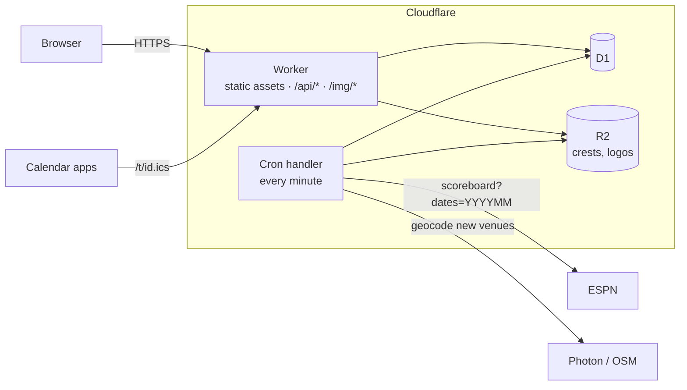

# footyplanner rebuild plan

Status: agreed 2026-11-18. Step 1 merged in [PR #2](https://github.com/ibbya04/footyplanner/pull/2). Step 2 (data layer) in progress. Decisions are recorded in [`docs/adr/`](adr/) as each step lands.

Goal: turn footyplanner into a full-stack CV project, with the backend and data pipeline as the headline. Modelled on the shape of [Rate My Uni's architecture](https://tadiwanashedzvoti.com/blogs/rate-my-uni-architecture.html) (separate frontend, API, database and object storage behind one edge, documented with a diagram), but running entirely on Cloudflare.

## Where it is today

- `index.html`: 2,573 lines of HTML, CSS and JS, including the ~260-line `KNOWN_VENUES` table and the hard-coded `COMPETITIONS`, `GROUPS` and `TBC_RULES`.
- `api/day.js` and `api/venue.js`: Vercel functions that proxy ESPN and Photon, cached with `s-maxage`.
- `slimEvent`, geocoding and `distanceKm` are duplicated between `index.html` and `api/_lib.js`.
- No database, no types, no tests, no CI. The stadium list is refreshed by hand with `scripts/build_venues.py`.

## Decisions

| #   | Decision                                         | Choice                                                                                                                                                                                  |
| --- | ------------------------------------------------ | --------------------------------------------------------------------------------------------------------------------------------------------------------------------------------------- |
| 1   | CV focus                                         | Full-stack, with the backend and data pipeline as the headline                                                                                                                          |
| 2   | No-backend mode (opening `index.html` as a file) | Dropped. The Worker is the only source of data                                                                                                                                          |
| 3   | Getting fixtures                                 | Cron only. Visitor requests never call ESPN or Photon                                                                                                                                   |
| 4   | Frontend                                         | Vite + React + TypeScript                                                                                                                                                               |
| 5   | Migration                                        | Same repo, step by step, one branch and pull request per step                                                                                                                           |
| 6   | Domain                                           | `*.workers.dev` for now. Custom domain and firewall rules later                                                                                                                         |
| 7   | Accounts                                         | None. Trips are anonymous                                                                                                                                                               |
| 8   | Repo layout                                      | pnpm workspaces: `apps/web`, `apps/api`, `packages/shared`. No Turborepo                                                                                                                |
| 9   | Workers                                          | One Worker serves the static assets, `/api/*` and the cron. Ingestion kept in its own module                                                                                            |
| 10  | API framework                                    | Hono + Zod (`@hono/zod-validator`), Hono RPC client for type-checked calls from the frontend                                                                                            |
| 11  | Database                                         | D1 + Drizzle. Migrations generated by drizzle-kit, applied by `wrangler d1 migrations`                                                                                                  |
| 12  | Order                                            | Move to Workers first, then the data layer, then React                                                                                                                                  |
| 13  | Map                                              | Leaflet via react-leaflet, keeping clustering and the Esri tiles                                                                                                                        |
| 14  | Styling                                          | CSS Modules, existing colour variables in a global file                                                                                                                                 |
| 15  | Frontend state                                   | TanStack Query for API data, filters in the URL, everything else in React state                                                                                                         |
| 16  | Cloudflare plan                                  | Free. Ingestion split into small cron runs with the work queue in D1                                                                                                                    |
| 17  | Live scores                                      | Refreshed every 2 minutes, only while a competition has a match in its kick-off window                                                                                                  |
| 18  | Data window                                      | Current season from 2026-08-01 plus everything published ahead. Nothing deleted                                                                                                         |
| 19  | Venues                                           | Geocoded by the cron (Photon, at most ~1/s). Manual corrections in `venue_overrides`. `KNOWN_VENUES` becomes seed data                                                                  |
| 20  | Fixtures API                                     | One `/api/fixtures` endpoint with venues included, max range 62 days, cached at the edge                                                                                                |
| 21  | Crests                                           | Copied into R2 by the cron, served from `/img/...`                                                                                                                                      |
| 22  | Saved trips                                      | Public read-only link plus secret edit token, and a subscribable `.ics` feed                                                                                                            |
| 23  | Tests                                            | Vitest unit tests, API and ingestion tests in the Workers runtime (`@cloudflare/vitest-plugin`, the renamed `vitest-pool-workers`) with saved ESPN responses, one Playwright smoke test |
| 24  | CI/CD                                            | GitHub Actions: typecheck, lint (ESLint + Prettier), test, build, preview upload on pull requests. On `main`: migrations, then `wrangler deploy`                                        |
| 25  | Monitoring                                       | `ingest_runs` table, `/api/status`, Workers Logs, rate limit on `/api/*`. No alerts yet                                                                                                 |
| 26  | Write-up                                         | README with a Mermaid diagram, ADRs in `docs/adr/`, a blog post at the end with real numbers                                                                                            |

## Architecture

### Constraints that shape ingestion (checked 2026-11-18)

- ESPN `scoreboard?dates=` rejects date ranges (HTTP 400) but accepts a single day, a month (`YYYYMM`) or a year (`YYYY&limit=1000`, where 1000 is the maximum). Every event includes the venue name, city and country.
- 26 competitions × about 10 months ≈ **260 month calls** per full season sweep.
- Workers Free plan: 50 outbound requests and **10 ms CPU** per run, 5 cron triggers per account. A month response takes about 1–2 ms to parse, so each run handles 2–3 league-months. Year responses (12–15 ms) are out.
- D1 Free plan: 100k row writes a day. Going over stops all queries until 00:00 UTC, so unchanged rows are never written.
- The Paid plan ($5/month) would allow the whole sweep in one hourly cron. The code should make that switch a config change.

## API

| Endpoint                             | Used by                                      | Notes                                                                                                                                                                                                        |
| ------------------------------------ | -------------------------------------------- | ------------------------------------------------------------------------------------------------------------------------------------------------------------------------------------------------------------ |
| `GET /api/fixtures?from=&to=&comps=` | Map pins and match list                      | Fixtures with teams, crests, kick-off, `timeConfirmed`, status, score and venue (`lat`, `lng`, `precision`). Max 62 days. Cached ~60 s if the range includes today, ~1 h for the future, longer for the past |
| `GET /api/competitions`              | Leagues picker, legend, TBC guidance         | Name, country, group, logo, colour, TBC rule. Replaces `COMPETITIONS`, `GROUPS` and `TBC_RULES` in the frontend. The cron reads the same list                                                                |
| `GET /api/status`                    | "Data updated 3 min ago" label, health check | Last successful ingest and coverage per competition, recent errors, last cron run                                                                                                                            |
| `POST /api/trips`                    | Save / share trip                            | Returns public `id` and secret `editToken`. Rate-limited                                                                                                                                                     |
| `GET /api/trips/{id}`                | Opening `/t/{id}`                            | Trip with current fixture details, so moved kick-offs show                                                                                                                                                   |
| `PUT /api/trips/{id}`                | Editing a saved trip                         | Needs `editToken` in a header                                                                                                                                                                                |
| `GET /t/{id}.ics`                    | Calendar subscriptions                       | Live feed that updates as kick-offs move or get confirmed                                                                                                                                                    |
| `/img/...`                           | Crests and logos                             | Static files from R2                                                                                                                                                                                         |

Removed: `/api/venue` (coordinates are already included in each fixture) and, once React is live, `/api/day`. The cron handler has no public URL.

## Database (D1)

- `competitions`: slug, name, country, group, logo, colour, TBC rule, active flag
- `teams`: ESPN id, names, crest (R2 key)
- `venues`: name, city, country, lat, lng, `precision` (stadium/city), `source` (seed/photon/manual)
- `venue_overrides`: manual corrections, managed through migrations
- `fixtures`: ESPN id, competition, kick-off, `time_valid`, status, scores, home, away, venue, `updated_at`
- `fixture_changes`: kick-off moved, time confirmed, status changes (powers the shortlist's "changed" warnings)
- `trips`: public id, edit token hash, payload, created and updated times
- `ingest_queue` / cursor: league-months still to fetch and when each was last fetched
- `ingest_runs`: start, end, calls made, rows changed, errors

## Ingestion

- Cron fires every minute. Each run takes the next 2–3 league-months from the queue, fetches them, compares with what's stored and writes only what changed.
- Full sweep: 1 Aug of the current season through the last published month. Near-term months are re-queued several times a day, later months less often.
- Live: every 2 minutes, re-fetch today (one day call per competition) only for competitions with a match in its kick-off window.
- Venues: new venue names are queued for Photon. Same strategy as today: city first, then the nearest `leisure:stadium` within 40 km, rejecting anything outside the UEFA region. `venue_overrides` takes priority.
- Crests: new crest URLs are copied into R2 once.
- Every run writes an `ingest_runs` row.

## Steps

Each step is its own branch and pull request, done in a git worktree. The site keeps working after every step. Tests and an ADR are written alongside each step.

1. **Move to Workers (1a)**
    - pnpm workspaces (`apps/web`, `apps/api`, `packages/shared`), TypeScript, ESLint, Prettier, `wrangler.jsonc`.
    - The Worker serves the current `index.html` as a static asset and a Hono port of `/api/day` (and `/api/venue` for now).
    - Move `slimEvent` and the shared helpers into `packages/shared`.
    - GitHub Actions CI (typecheck, lint, test, preview upload, deploy on `main`).
    - Replace `scripts/dev-server.js` with `wrangler dev`.
    - Deploy to `workers.dev`, check parity, then switch off Vercel.
2. **Data layer (1b)**
    - D1 schema and migrations with Drizzle. Seed `competitions` and `venues` (from `KNOWN_VENUES`).
    - Cron ingestion with the work queue, change detection, live refresh, venue geocoding and R2 crests.
    - `/api/fixtures`, `/api/competitions`, `/api/status`, edge caching, rate limit (check the Workers rate-limiting binding is on the Free plan first).
    - Ingestion tests with saved ESPN responses.
    - Delete `scripts/build_venues.py`.
3. **React rewrite (1c)**
    - `apps/web` with Vite + React + TypeScript, react-leaflet + clustering, CSS Modules, TanStack Query, filters in the URL, Hono RPC client.
    - Rebuild every current feature: date picker, leagues, near-a-place with travel times, shortlist itinerary with clash warnings, route on the map, ICS export, TBC guidance, time zone toggle, resizable sidebar.
    - "Data updated" label from `/api/status`.
    - Playwright smoke test.
    - Remove `/api/day`, `/api/venue` and the old `index.html`.
4. **Saved trips**
    - `trips` table, `POST`/`GET`/`PUT /api/trips`, `/t/{id}` page, `/t/{id}.ics` feed (ICS code moved into `packages/shared`).
5. **Docs**
    - README with the Mermaid diagram, setup and deploy instructions.
    - ADRs in `docs/adr/`: one Worker over two services, D1 over Postgres, cron-only ingestion, Free-plan batching, anonymous trips with edit tokens.
    - Blog post with real numbers: requests per page load before and after, cold-load time, ESPN calls per day, cost.

## Later

- Custom domain on Cloudflare Registrar, firewall (WAF) and rate-limit rules.
- Accounts (magic link) for "my trips" across devices.
- MapLibre GL and vector tiles.
- Email or Slack alerts when ingestion fails.
