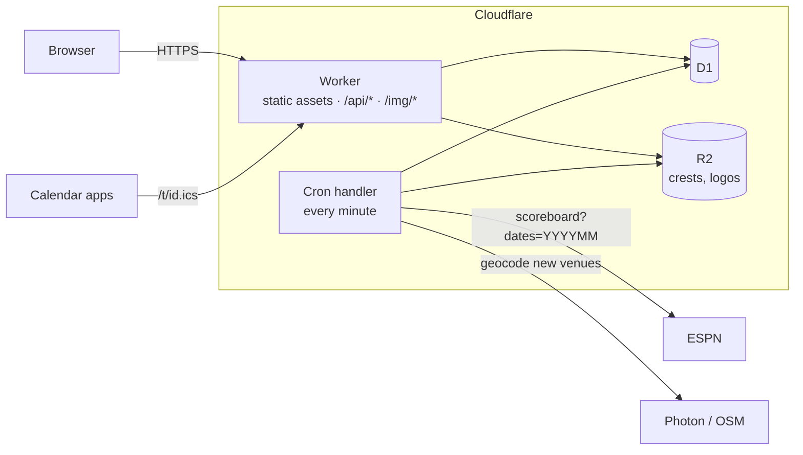

# footyplanner rebuild plan

Status: agreed 2026-11-18. Step 1 merged in [PR #2](https://github.com/ibbya04/footyplanner/pull/2). Step 2 (data layer) merged in [PR #4](https://github.com/ibbya04/footyplanner/pull/4) and tuned in [PR #5](https://github.com/ibbya04/footyplanner/pull/5). Reviewed against production after step 2 (see [Follow-ups](#follow-ups)). Step 3 is split into 3a–3e; 3a (React skeleton at `/next/`) in progress. Decisions are recorded in [`docs/adr/`](adr/) as each step lands.

Goal: turn footyplanner into a full-stack CV project, with the backend and data pipeline as the headline. Modelled on the shape of [Rate My Uni's architecture](https://tadiwanashedzvoti.com/blogs/rate-my-uni-architecture.html) (separate frontend, API, database and object storage behind one edge, documented with a diagram), but running entirely on Cloudflare.

## Where it is today

- `index.html`: 2,573 lines of HTML, CSS and JS, including the ~260-line `KNOWN_VENUES` table and the hard-coded `COMPETITIONS`, `GROUPS` and `TBC_RULES`.
- `api/day.js` and `api/venue.js`: Vercel functions that proxy ESPN and Photon, cached with `s-maxage`.
- `slimEvent`, geocoding and `distanceKm` are duplicated between `index.html` and `api/_lib.js`.
- No database, no types, no tests, no CI. The stadium list is refreshed by hand with `scripts/build_venues.py`.

## Decisions

| #   | Decision                                         | Choice                                                                                                                                                                                  |
| --- | ------------------------------------------------ | --------------------------------------------------------------------------------------------------------------------------------------------------------------------------------------- |
| 1   | CV focus                                         | Full-stack, with the backend and data pipeline as the headline                                                                                                                          |
| 2   | No-backend mode (opening `index.html` as a file) | Dropped. The Worker is the only source of data                                                                                                                                          |
| 3   | Getting fixtures                                 | Cron only. Visitor requests never call ESPN or Photon                                                                                                                                   |
| 4   | Frontend                                         | Vite + React + TypeScript                                                                                                                                                               |
| 5   | Migration                                        | Same repo, step by step, one branch and pull request per step                                                                                                                           |
| 6   | Domain                                           | `*.workers.dev` for now. Custom domain and firewall rules later                                                                                                                         |
| 7   | Accounts                                         | None. Trips are anonymous                                                                                                                                                               |
| 8   | Repo layout                                      | pnpm workspaces: `apps/web`, `apps/api`, `packages/shared`. No Turborepo                                                                                                                |
| 9   | Workers                                          | One Worker serves the static assets, `/api/*` and the cron. Ingestion kept in its own module                                                                                            |
| 10  | API framework                                    | Hono + Zod (`@hono/zod-validator`), Hono RPC client for type-checked calls from the frontend                                                                                            |
| 11  | Database                                         | D1 + Drizzle. Migrations generated by drizzle-kit, applied by `wrangler d1 migrations`                                                                                                  |
| 12  | Order                                            | Move to Workers first, then the data layer, then React                                                                                                                                  |
| 13  | Map                                              | Leaflet via react-leaflet, keeping clustering and the Esri tiles                                                                                                                        |
| 14  | Styling                                          | CSS Modules, existing colour variables in a global file                                                                                                                                 |
| 15  | Frontend state                                   | TanStack Query for API data, filters in the URL, everything else in React state                                                                                                         |
| 16  | Cloudflare plan                                  | Free for now, under review: runs use 22–34 ms of CPU against a 10 ms limit (see Follow-ups). Ingestion split into small cron runs with the work queue in D1                             |
| 17  | Live scores                                      | Refreshed every 2 minutes, only while a competition has a match in its kick-off window. Live runs take the even minutes from sweeps                                                     |
| 18  | Data window                                      | Current season from `SEASON_START` (2026-08, set by hand each summer for now) plus everything published ahead. Nothing deleted                                                          |
| 19  | Venues                                           | Geocoded once by the cron (Photon, one venue per run). Manual corrections in `venue_overrides`. `KNOWN_VENUES` becomes seed data                                                        |
| 20  | Fixtures API                                     | One `/api/fixtures` endpoint with venues included, max range 62 days, cached at the edge                                                                                                |
| 21  | Crests                                           | Copied into R2 by the cron, served from `/img/...`                                                                                                                                      |
| 22  | Saved trips                                      | Public read-only link plus secret edit token, and a subscribable `.ics` feed                                                                                                            |
| 23  | Tests                                            | Vitest unit tests, API and ingestion tests in the Workers runtime (`@cloudflare/vitest-plugin`, the renamed `vitest-pool-workers`) with saved ESPN responses, one Playwright smoke test |
| 24  | CI/CD                                            | GitHub Actions: typecheck, lint (ESLint + Prettier), test, build, preview upload on pull requests. On `main`: migrations, then `wrangler deploy`                                        |
| 25  | Monitoring                                       | `ingest_runs` table, `/api/status`, Workers Logs, rate limit on `/api/*`. No alerts yet                                                                                                 |
| 26  | Write-up                                         | README with a Mermaid diagram, ADRs in `docs/adr/`, a blog post at the end with real numbers                                                                                            |

## Architecture

### Constraints that shape ingestion (checked 2026-11-18)

- ESPN `scoreboard?dates=` rejects date ranges (HTTP 400) but accepts a single day, a month (`YYYYMM`) or a year (`YYYY&limit=1000`, where 1000 is the maximum). Every event includes the venue name, city and country.
- 26 competitions × 13 months (2026-08 to 2027-08) = **338 month calls** per full season sweep.
- ESPN's API is unofficial and undocumented. It can change or refuse requests (one HTTP 403 on 2026-11-18). Failures show on `/api/status` and back off per league-month.
- Workers Free plan: 50 outbound requests and **10 ms CPU** per run, 5 cron triggers per account. Each run was planned to handle 2–3 league-months, assuming 1–2 ms to parse a month. In production, 2 months took 47–86 ms of CPU, so each run now handles 1. Even then runs take 22–34 ms, including a sweep that wrote nothing, so the cost is fixed per run rather than driven by writes. Runs still finish (outcome `ok`), but the Free plan may cut off a Worker that goes over consistently. Year responses are out.
- D1 Free plan: 100k row writes a day. Going over stops all queries until 00:00 UTC, so unchanged rows are never written.
- The Paid plan ($5/month) would allow the whole sweep in one hourly cron. The code should make that switch a config change.

## API

| Endpoint                             | Used by                                      | Notes                                                                                                                                                                                                        |
| ------------------------------------ | -------------------------------------------- | ------------------------------------------------------------------------------------------------------------------------------------------------------------------------------------------------------------ |
| `GET /api/fixtures?from=&to=&comps=` | Map pins and match list                      | Fixtures with teams, crests, kick-off, `timeConfirmed`, status, score and venue (`lat`, `lng`, `precision`). Max 62 days. Cached ~60 s if the range includes today, ~1 h for the future, longer for the past |
| `GET /api/competitions`              | Leagues picker, legend, TBC guidance         | Name, country, group, logo, colour, TBC rule. Replaces `COMPETITIONS`, `GROUPS` and `TBC_RULES` in the frontend. The cron reads the same list                                                                |
| `GET /api/status`                    | "Data updated 3 min ago" label, health check | Last successful ingest and coverage per competition, recent errors, last cron run                                                                                                                            |
| `POST /api/trips`                    | Save / share trip                            | Returns public `id` and secret `editToken`. Rate-limited                                                                                                                                                     |
| `GET /api/trips/{id}`                | Opening `/t/{id}`                            | Trip with current fixture details, so moved kick-offs show                                                                                                                                                   |
| `PUT /api/trips/{id}`                | Editing a saved trip                         | Needs `editToken` in a header                                                                                                                                                                                |
| `GET /t/{id}.ics`                    | Calendar subscriptions                       | Live feed that updates as kick-offs move or get confirmed                                                                                                                                                    |
| `/img/...`                           | Crests and logos                             | Static files from R2                                                                                                                                                                                         |

Removed: `/api/venue` (coordinates are already included in each fixture) and, once React is live, `/api/day`. The cron handler has no public URL.

## Database (D1)

- `competitions`: slug, name, country, group, logo, colour, TBC rule, active flag
- `teams`: ESPN id, names, crest (R2 key)
- `venues`: name, city, country, lat, lng, `precision` (stadium/city), `source` (seed/photon/manual)
- `venue_overrides`: manual corrections, managed through migrations
- `fixtures`: ESPN id, competition, kick-off, `time_valid`, status, scores, home, away, venue, `updated_at`
- `fixture_changes`: kick-off moved, time confirmed, status changes (powers the shortlist's "changed" warnings)
- `trips`: public id, edit token hash, payload, created and updated times
- `ingest_queue`: league-months still to fetch and when each was last fetched
- `ingest_runs`: start, end, calls made, rows changed, errors

## Ingestion

- Cron fires every minute. Each run does one job: a live refresh or a sweep. A sweep takes the next due league-month from the queue (`INGEST_MONTHS_PER_RUN`, 1 on Free), fetches it, compares with what's stored and writes only what changed.
- Full sweep: 1 Aug of the current season through the last published month. Near-term months are re-queued several times a day, later months less often. Once the first sweep is done, that's about 500 month calls a day against 1,440 runs.
- Live: on even minutes, re-fetch today (one day call per competition, at most 6) for competitions with a match that kicked off in the last 3 hours or starts in the next 10 minutes. That run skips the sweep, so on match days sweeps run every other minute and backlogs (the first sweep, catching up after an outage) clear about twice as slowly. Accepted, because the steady-state load is well below capacity.
- Venues: new venue names are queued for Photon. Same strategy as today: city first, then the nearest `leisure:stadium` within 40 km, rejecting anything outside the UEFA region. `venue_overrides` takes priority. Each venue is located once. The first sweep found about 300 venues the seed didn't have (mostly cup ties at small grounds), a backlog of a few hours. After that, new venues are a trickle (cup draws, European ties, promoted teams). Photon has brief outages (HTTP 521); failed lookups retry later. When no stadium is found, the venue is saved at city level (`precision: city`) for good unless an override is added.
- Crests: new crest URLs are copied into R2 once.
- Every run writes an `ingest_runs` row.

## Steps

Each step is its own branch and pull request, done in a git worktree. The site keeps working after every step. Tests and an ADR are written alongside each step.

1. **Move to Workers (1a)**
    - pnpm workspaces (`apps/web`, `apps/api`, `packages/shared`), TypeScript, ESLint, Prettier, `wrangler.jsonc`.
    - The Worker serves the current `index.html` as a static asset and a Hono port of `/api/day` (and `/api/venue` for now).
    - Move `slimEvent` and the shared helpers into `packages/shared`.
    - GitHub Actions CI (typecheck, lint, test, preview upload, deploy on `main`).
    - Replace `scripts/dev-server.js` with `wrangler dev`.
    - Deploy to `workers.dev`, check parity, then switch off Vercel. (Done: Vercel switched off 2026-11-18.)
2. **Data layer (1b)**
    - D1 schema and migrations with Drizzle. Seed `competitions` and `venues` (from `KNOWN_VENUES`).
    - Cron ingestion with the work queue, change detection, live refresh, venue geocoding and R2 crests.
    - `/api/fixtures`, `/api/competitions`, `/api/status`, edge caching, rate limit (the rate-limiting binding works on the Free plan).
    - Ingestion tests with saved ESPN responses.
    - Delete `scripts/build_venues.py`.
3. **React rewrite (1c)**, split into five pull requests. The React app is built at `/next/` while the legacy page stays at `/`, so each one deploys working software ([ADR 0012](adr/0012-react-frontend-built-alongside-the-legacy-page.md)).
    - **3a. Skeleton:** `apps/web` with Vite, React and TypeScript, served by the Worker at `/next/`. Hono RPC client, TanStack Query, CSS Modules with the legacy colour variables. Map (react-leaflet, clustering, Esri tiles) showing `/api/fixtures` for the next 7 days. Playwright smoke test against `wrangler dev` with seeded fixtures. CI builds the frontend and runs Playwright.
    - **3b. Browse:** date picker (ranges over 62 days, the `/api/fixtures` limit, split into several requests), leagues picker from `/api/competitions`, filters in the URL, match list, time zone toggle, TBC guidance, "location approximate" hint for venues with `precision: city`, "Data updated" label from `/api/status`, resizable sidebar.
    - **3c. Near a place:** place search, distance and travel-time estimates (moved into `packages/shared`), sort by distance. Decide whether the browser keeps calling Photon for place search or goes through a cached `/api/places`.
    - **3d. Shortlist:** shortlist in `localStorage` (reading the legacy keys, so existing shortlists carry over), itinerary with clash warnings and travel between matches, route on the map, ICS export, Google Maps links.
    - **3e. Cutover:** React moves to `/`. Remove `/api/day`, `/api/venue` and the legacy `index.html`. Playwright covers the main journeys.
4. **Saved trips**
    - `trips` table, `POST`/`GET`/`PUT /api/trips`, `/t/{id}` page, `/t/{id}.ics` feed (ICS code moved into `packages/shared`).
5. **Docs**
    - README with the Mermaid diagram, setup and deploy instructions.
    - ADRs in `docs/adr/`: 0001–0011 cover steps 1 and 2 (one Worker, D1, cron-only ingestion, Free-plan batching and more). 0012 covers step 3's frontend. Still to write: anonymous trips with edit tokens.
    - Blog post with real numbers: requests per page load before and after, cold-load time, ESPN calls per day, cost.

## Follow-ups

Found after step 2 went live. Not part of a step yet; pick up before or alongside step 3.

- **CPU per cron run (check 2026-11-19).** Once the first sweep and the venue and crest backlogs are done (`/api/status` pending near 0), re-measure with `wrangler tail`. Under ~10 ms: nothing to do. Still ~20 ms or more: either profile and cut the fixed cost per run (JSON parsing, Drizzle, geocoding and crest steps), or move to Workers Paid ($5/month) and update decision 16 and ADR 0009.
- **Live refresh starves competitions past 6.** `liveTargets` in `apps/api/src/ingest/run.ts` takes at most 6 competitions with no order, so the same 6 are likely picked every time. On a Saturday afternoon more than 6 can be on (English leagues 1–4, Scottish Premiership, Bundesliga, cups), and the rest get no live scores until a sweep. Fix: keep the cap but rotate, e.g. oldest live refresh first. Test it with the fake ESPN upstream.
- **Season rollover is manual.** `SEASON_START` in `wrangler.jsonc` must be bumped each summer. Consider deriving it (August of this year, or last year before August).
- **D1 write budget isn't visible.** Add rows written today to `/api/status`, since going over 100k stops every query until 00:00 UTC.

## Later

- Custom domain on Cloudflare Registrar, firewall (WAF) and rate-limit rules.
- Accounts (magic link) for "my trips" across devices.
- MapLibre GL and vector tiles.
- Email or Slack alerts when ingestion fails.
